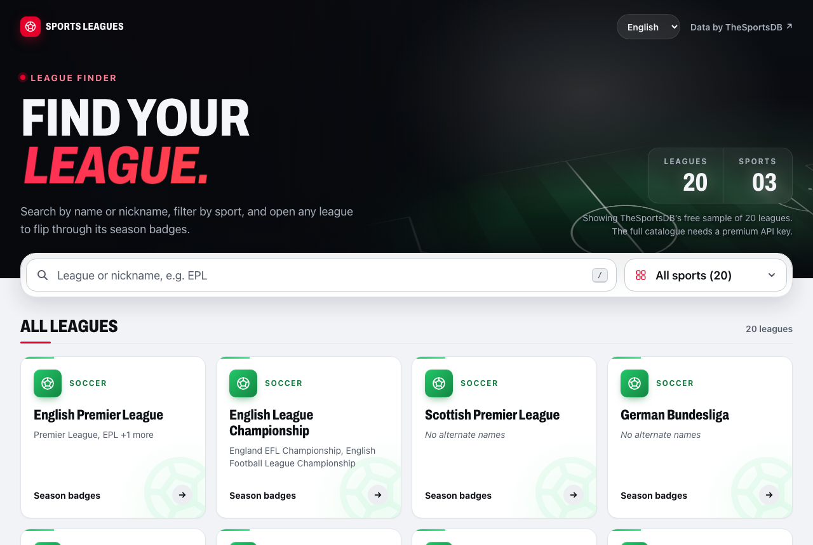
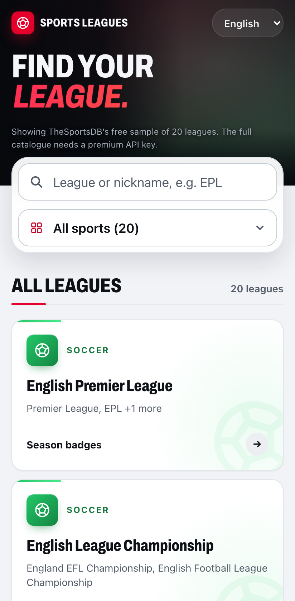
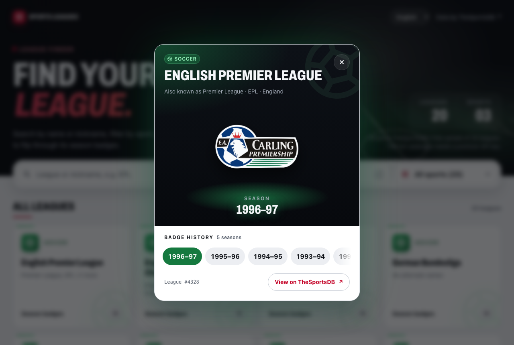
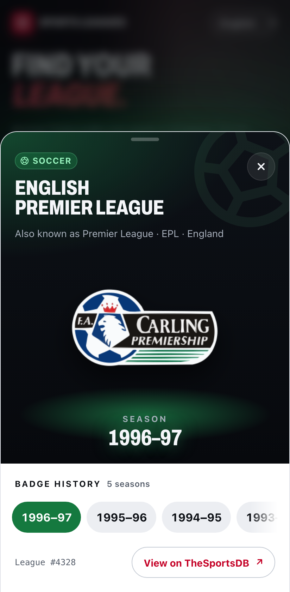
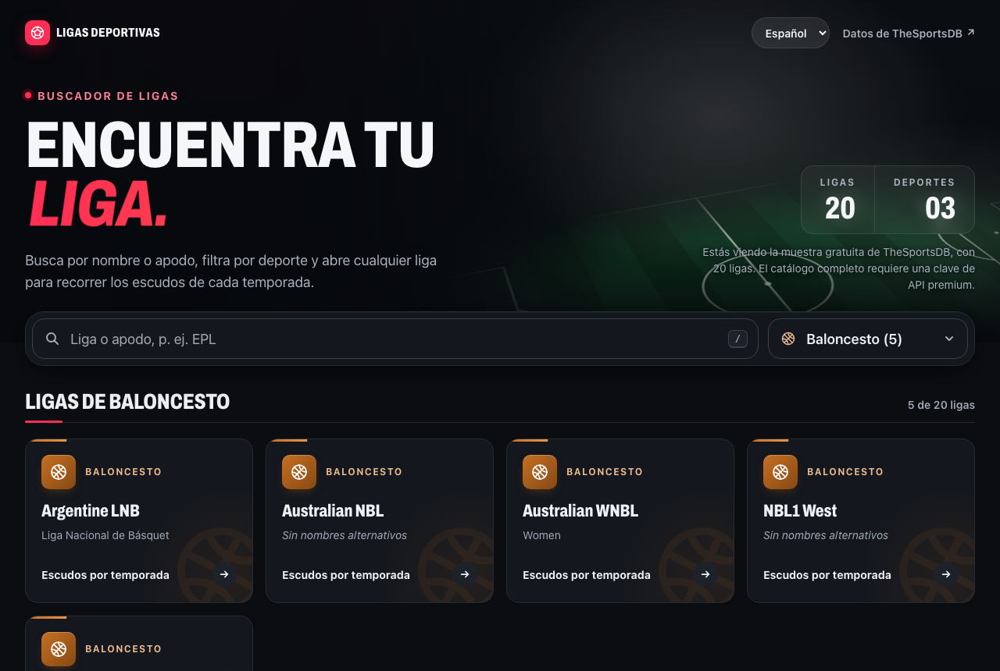
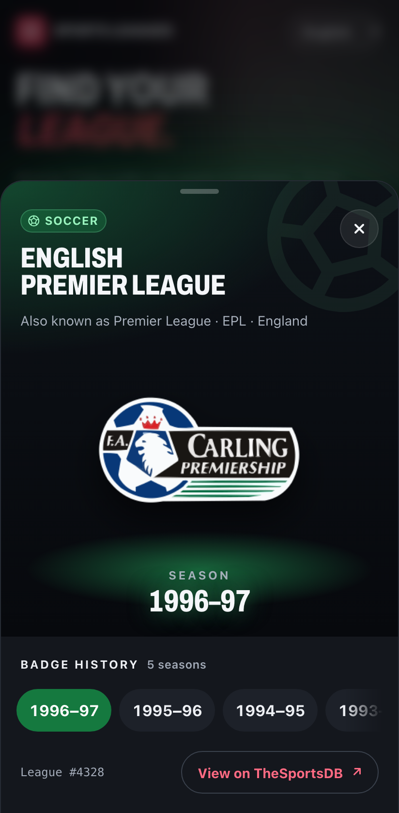

# Sports Leagues

A Vue 3 single-page app that lists sports leagues from [TheSportsDB](https://www.thesportsdb.com), with search, a sport dropdown, and season badges on click.

| Desktop | Mobile |
| --- | --- |
|  |  |
|  |  |
|  |  |

## Run it

Needs Node 22.18+ or 24.12+ and pnpm (`corepack enable` picks up the version pinned in `package.json`).

```sh
pnpm install
pnpm dev             # http://localhost:5173
```

| Command | What it does |
| --- | --- |
| `pnpm test` | 80 unit and component tests (Vitest) |
| `pnpm test:e2e` | 70 browser tests in Chrome (desktop and mobile), Firefox and WebKit (Playwright; first run: `pnpm exec playwright install chromium firefox webkit`) |
| `pnpm check` | Type-check, lint, format check, unit and e2e tests: what CI runs |
| `pnpm build` | Type-check and production build to `dist/` |

No API key is needed. `VITE_SPORTSDB_API_KEY=<key>` in `.env.local` uses a premium key instead.

## Who it's for

The brief describes this as a component of an online bookmaker. I assumed its user is on an Android phone, on prepaid data and a connection that drops, and knows leagues by their nicknames. That assumption decided most of what follows. Responses are kept in `localStorage`, so a reload or a second visit costs no data, and when TheSportsDB can't be reached the app shows the last list it saved, says how old it is, and refreshes when the phone is back online. Badges load as small thumbnails, and the only web font is a 14.5 kB cut of one weight. Search matches nicknames and ignores accents. On phones the hero shrinks so the first leagues are on the first screen, the whole card is the tap target, the sport dropdown opens the system picker, and the badge opens as a bottom sheet.

## What it does

- Lists every league with its name (`strLeague`), sport (`strSport`) and alternate names (`strLeagueAlternate`).
- Search by name or nickname, ignoring case and accents and ranked by match quality, with matches highlighted. `EPL` finds the English Premier League; `basquet` finds "Liga Nacional de Básquet".
- A sport dropdown built from the data, with counts that follow the search.
- Clicking a league opens its season badge in a dialog (a bottom sheet on phones), starting at the latest season that has one, with the other seasons in a strip.
- Loading skeletons, errors with retry, empty states and a "no badge" state.
- The URL holds the filters and the open league (`?q=epl&sport=Soccer&league=4328`), so any view can be shared.
- English and Spanish, following the browser, with a switcher that remembers the choice.
- Keyboard, screen reader, light and dark themes, and reduced motion are covered; axe reports no violations.

## Things worth knowing about the API

1. The brief's API key `3` is retired: every call returns HTTP 403 asking for the new test key, `123`. The app uses `123`.
2. The free key returns a sample of 10 Soccer leagues with no `strLeagueAlternate`. Built only against that, the dropdown would have one option, a required field would always be empty, and "EPL" would find nothing. So:
   - the UI is built from the data rather than hardcoded, and the app tells the user it is showing a sample;
   - the alternate names for the 10 sample leagues were captured from `lookupleague.php`, which does return them, by `scripts/capture-alternate-names.mjs`, and ship with the app in `src/api/alternateNames.json` (under 1 kB). They fill in only where the API sends none, so a premium list with its own names is untouched. Fetching them live would take one request per league, up to 17 kB each, and the free key's rate limit (below) would then block the badge request;
   - the tests and screenshots also use real API data that adds Basketball and Motorsport leagues, so the sport filter is exercised for real.
3. Many seasons have no badge (`strBadge: null`), and some leagues have none at all. The app picks the latest season that has one and says so when none does.
4. The free key is documented at 30 requests per minute, but I measured HTTP 429 after about 10 requests in five seconds. The 429 has no CORS header, so the browser reports it as a network error. A first visit makes one request, and each badge one more; after that the cache answers. A 429 is never retried automatically.

## Design decisions

Code is split into layers. `api/` knows HTTP and TheSportsDB, `domain/` is pure functions (search, ranking, badge choice), `stores/` hold state, and components render. Each layer is tested on its own.

```
src/
  api/          http.ts (fetch, timeout, retry, typed errors) · cache.ts · parse.ts · sportsDb.ts
  domain/       search.ts · badges.ts · sportColor.ts · types.ts
  stores/       leagues.ts (list, filters, selection, offline fallback) · seasons.ts (badges per league)
  i18n/         index.ts · locales/en.ts · locales/es.ts
  composables/  useUrlState · useSlashToFocus · useTilt · useLabels
  components/   AppHero · LeagueFilters · LeagueResults · LeagueCard · LeagueDialog · BadgeImage
                StatusPanel · SportTag · SportIcon · HighlightText · CountUp · LocaleSwitcher
```

Responses are parsed at the edge. The API is loosely typed (nulls, empty strings, a comma-separated alias field), so `parse.ts` validates every response and maps it to the app's own `League` and `Season` types. A malformed entry is skipped instead of breaking the list.

The cache is about 120 lines of my own code rather than a library, because two GET endpoints don't justify TanStack Query. It shares one in-flight request between callers, so two quick clicks make one fetch. Leagues are kept for 4 hours, matching the server's `max-age`, and badges for 24. Entries persist in `localStorage` and survive quota errors and private mode. Failures are never cached, so "Try again" really tries again. Expired entries stay in storage until a fresh response replaces them, which is what the offline fallback reads. A reload renders the cached list on the first frame, without a spinner.

Badge state in Pinia is keyed by league id, so opening league A and then B before A answers can't show A's badge under B's name.

Errors are explained, not swallowed. Network errors, timeouts and 5xx get one retry with backoff; 4xx and 429 get none. Stores keep the error's kind, and the UI turns it into a message in the user's language.

The sport filter is a native `<select>`. On phones it opens the system picker, and it stays one line when a premium key returns dozens of sports. The selected sport's icon shows inside it. With a mouse, browsers that support customizable selects (Chrome and Edge 135+, and current WebKit) draw the option list in the app's style, with each sport's icon; everywhere else the browser's own list is used.

The dialog is a native `<dialog>`: `showModal()` gives focus trapping, Escape, an inert background and focus return without a library.

Styles are Tailwind v4 over design tokens, with no UI kit. Tailwind's default palette is off, so every class maps to a token, and the dark theme only swaps token values. The bundle is 67 kB of JavaScript and 12 kB of CSS gzipped.

Body text uses the system font, which costs nothing to load. Headings, scores and league names use Archivo, cut from the 90 kB variable font down to one static condensed ExtraBold instance of 14.5 kB with fontTools' instancer. Accented Latin outside Latin-1 is a second 13 kB file that the browser fetches only when a league name needs it. Archivo is under the OFL, and the licence ships next to the files in `src/assets/fonts/`.

Every animation ends, and with reduced motion there are none; an e2e test asserts that.

Localization uses vue-i18n. `es.ts` is typed against `en.ts`, so a missing key fails the type-check. Messages are full sentences with placeholders, because word order differs between languages.

## Testing

The unit tests cover HTTP (retry, timeout, 429, abort), the cache (TTL, de-duplication, persistence, corrupt storage, quota, stale entries), parsing against real responses, search ranking and badge choice. Component tests mount the whole app with a fake API client. The Playwright tests run against the production build in desktop Chrome, a Pixel 7 viewport, Firefox and WebKit, with the API mocked from recorded fixtures. They cover nickname search on the free key's real list, caching across a reload (counting requests), a slow API, the saved list when the API is unreachable after the cache expires, focus return after Escape, no horizontal scroll at 320px, and axe in both themes and both languages. One smoke test hits the live API, including a nickname search (`SKIP_LIVE=1` skips it).

## With more time

- A service worker, so the page itself opens with no connection, not only the data.
- Virtualise the list for the full premium catalogue; 20 cards don't need it.
- Preload a badge on hover or focus.
- Precompile the i18n messages and drop vue-i18n's message compiler from the bundle.

## AI tools

See [AI_NOTES.md](AI_NOTES.md).
